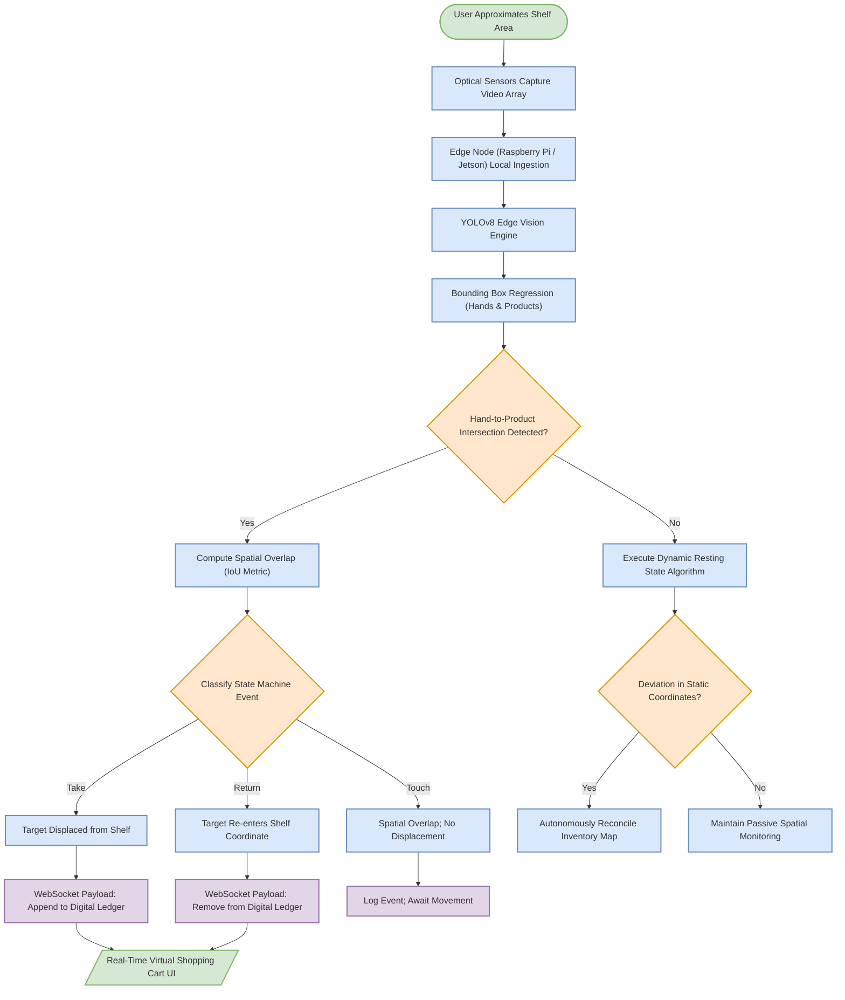

# Decentralized Edge-Based Grab-and-Go Retail System Flowchart

Here is the modernized, professional flowchart for your patent. It has been redesigned to clearly illustrate the deterministic logic pipeline, separating the "Interaction" path from the "Self-Healing/Passive" path.

---

## Process & Function Breakdown

The system operates in a constant, deterministic loop divided into **Five Primary Modules**:

### 1. Vision Acquisition Module (Data Intake)
*   **Function:** Local USB or CSI optical sensors continuously capture the physical retail environment and customer hand movements. 
*   **Advantage:** Processing happens purely on the Edge Node (e.g., Raspberry Pi, Jetson Nano), ensuring zero-latency and complete data privacy without sending video to the cloud.

### 2. AI Vision Engine (Processing)
*   **Function:** Feeds the captured frames into a lightweight, quantized YOLOv8 object detection model.
*   **Action:** It actively tracks and regresses bounding boxes for two specific classes: human hands and retail product packaging.

### 3. Spatial Interaction & Deterministic Logic (The "Yes" Branch)
*   **Function:** Acts as the primary decision-making layer when a customer interacts with the shelf.
*   **Logic:** Calculates the Intersection over Union (IoU) between the hand and the product. Based on movement, it deterministically classifies the interaction into three states:
    *   **Touch:** The hand overlaps the item, but the item doesn't move. (Logs and waits).
    *   **Take:** The item is removed from its mapped shelf coordinate. (Triggers Add payload).
    *   **Return:** The item is placed back into a valid shelf coordinate. (Triggers Remove payload).

### 4. Dynamic Resting State Algorithm / Self-Healing Mapping (The "No" Branch)
*   **Function:** Solves the problem of messy shelves and displaced items without human intervention.
*   **Logic:** When no hands are interacting with the shelf, the system passively monitors all items. If an item is displaced by a customer and left in a new spot (deviation detected), the algorithm autonomously "learns" the new coordinate and updates the internal inventory map.

### 5. Zero-Latency Synchronization Layer (Execution & Output)
*   **Function:** A lightweight WebSocket server that bridges the AI logic with the front-end interface.
*   **Action:** Instantly pushes validated JSON payloads (Add/Remove) to the user's mobile app or digital ledger, updating the virtual shopping cart in real-time.
